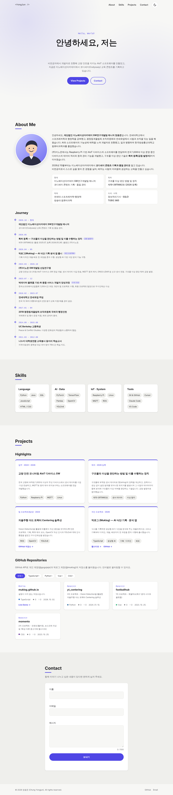
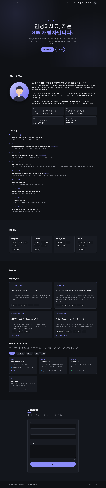
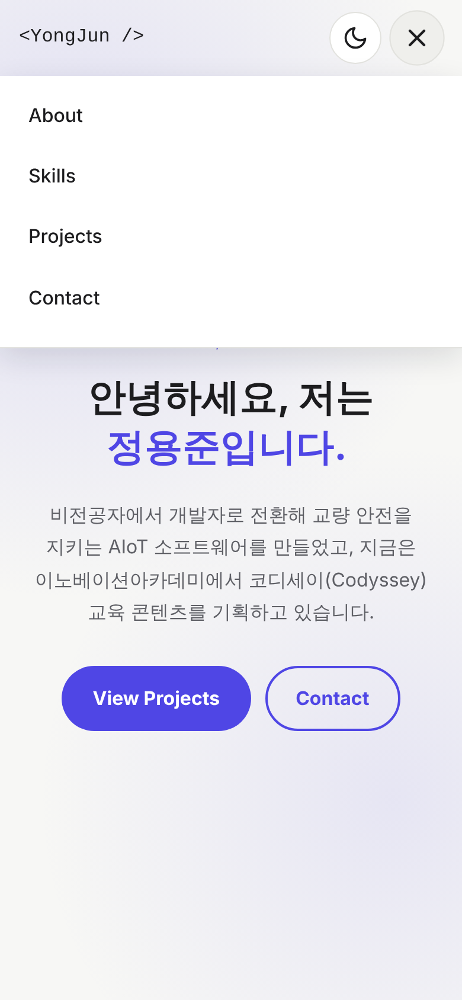
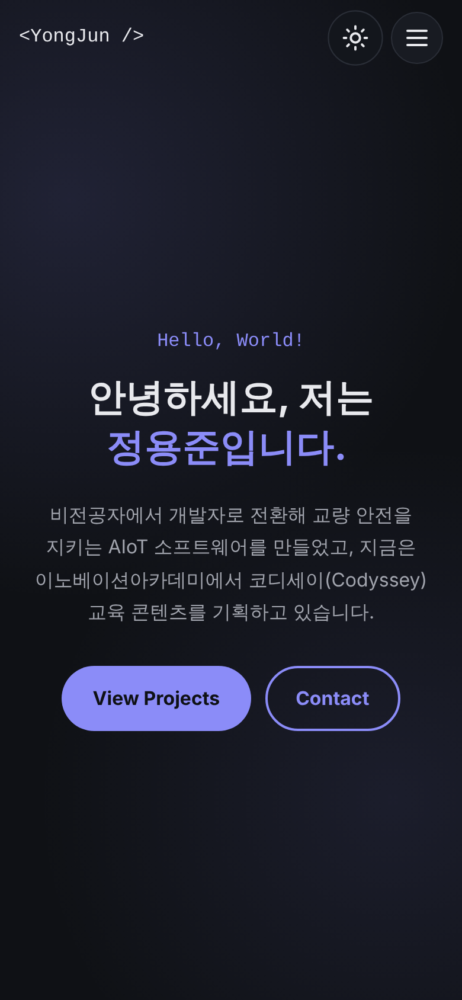
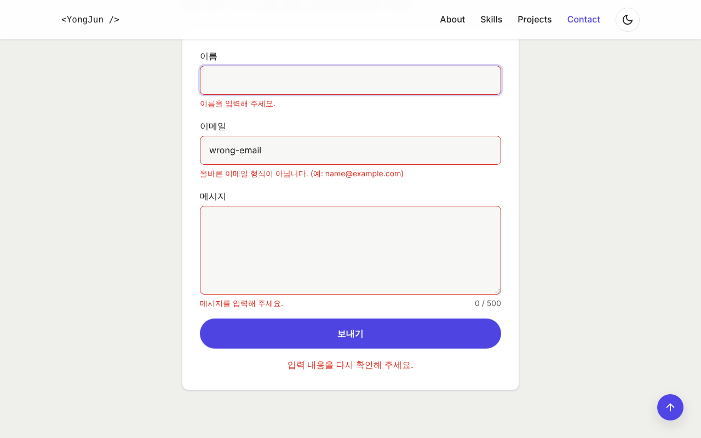
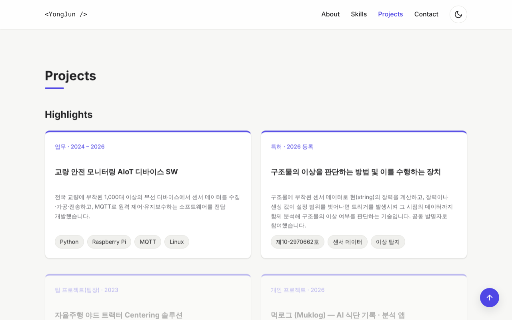
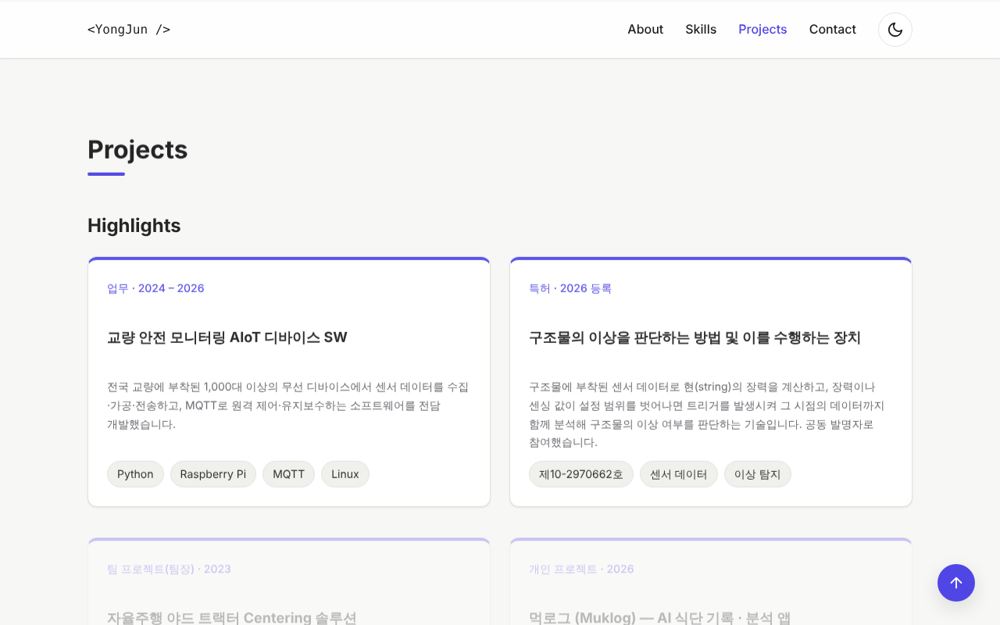

# 정용준 포트폴리오 — 나를 소개하는 웹페이지

SW 개발자이자 교육 콘텐츠 기획자 정용준(GitHub [@gogojeje1022](https://github.com/gogojeje1022))의 포트폴리오입니다.
외부 라이브러리 없이 **순수 HTML / CSS / JavaScript**만으로 만든 반응형 포트폴리오입니다.
"사용자 이벤트 → 상태 변경 → 화면 업데이트" 흐름을 직접 구현하는 것을 목표로 했습니다.

- **배포 URL**: https://gogojeje1022.github.io/
- **저장소 URL**: https://github.com/gogojeje1022/gogojeje1022.github.io

## 스크린샷

| 데스크톱 | 다크 모드 | 모바일 |
| --- | --- | --- |
|  |  |  |

| 모바일 메뉴 | 모바일 다크 모드 | 폼 유효성 검사 |
| --- | --- | --- |
|  |  |  |

| 로딩 상태 | 에러 상태 | 빈 상태 |
| --- | --- | --- |
|  |  |  |

## 사용 기술

- HTML5 (시맨틱 마크업, 접근성 속성)
- CSS3 (CSS 변수, Flexbox, Grid, 미디어 쿼리, transition/animation)
- JavaScript ES6+ (DOM API, 이벤트, `fetch` + `async/await`, Intersection Observer, localStorage)
- GitHub REST API · GitHub Pages
- Google Fonts (Noto Sans KR, JetBrains Mono)

## 폴더 구조

```
portfolio/
├── index.html
├── css/
│   └── style.css        # 디자인 토큰(:root / [data-theme="dark"]) + 모바일 퍼스트 반응형
├── js/                  # 모두 defer로 연결, 아래 순서대로 실행
│   ├── config.js        # GitHub 아이디·기준값 등 설정 (가장 먼저 수정할 파일)
│   ├── utils.js         # $, $$, escapeHTML, formatDate 등 공용 함수
│   ├── theme.js         # 다크 모드 + localStorage + 시스템 테마 감지
│   ├── ui.js            # 햄버거 메뉴, 부드러운 스크롤, 스크롤 상태, 등장 애니메이션, 타이핑 효과
│   ├── projects.js      # GitHub API 연동, 로딩/성공/에러/빈 상태, 언어 필터
│   └── form.js          # Contact 폼 유효성 검사
└── images/
    ├── profile.svg      # 프로필 일러스트
    ├── favicon.svg
    └── screenshots/
```

## 시작하기

1. GitHub 아이디 목록(`githubUsernames`: `gogojeje1022`, `muklog`)·타이핑 문구 등 설정은 `js/config.js`, 소개·경력·스킬 내용은 `index.html`에서 수정합니다.
2. 프로필 사진을 쓰려면 `images/`에 넣고 About의 ``를 바꿉니다.
3. VS Code에서 `index.html`을 열고 **Live Server**(Go Live)로 실행합니다.

## 기능 및 기준값

| 기능 | 내용 | 기준값 (`config.js`) |
| --- | --- | --- |
| 햄버거 메뉴 | 768px 미만에서 표시, 클릭 시 `.active` 토글. ESC·바깥 클릭·메뉴 클릭 시 닫힘 | — |
| 부드러운 스크롤 | 앵커 클릭 시 `preventDefault()` 후 `scrollIntoView({ behavior: 'smooth' })` | — |
| 네비게이션 배경 변경 | 스크롤 위치가 기준 이상이면 `.is-scrolled` | **60px** (`navScrollThreshold`) |
| 맨 위로 버튼 | 기준 이상 스크롤하면 표시, 클릭 시 맨 위로 | **300px** (`scrollTopThreshold`) |
| 스크롤 애니메이션 | Intersection Observer로 `.reveal` 요소 등장 | **threshold 0.2** (`revealThreshold`) |
| 다크 모드 | `<html data-theme>` 전환, localStorage 저장 → 새로고침 후 유지 | — |
| GitHub 프로젝트 | 두 계정(@gogojeje1022, @muklog) 저장소를 `Promise.all`로 동시에 불러와 합침. 포크 제외, 최근 푸시 순 최대 12개, 세션 캐시 10분 | `maxProjects`, `excludeForks`, `cacheMinutes` |
| 폼 검증 | 필수값, 이메일 형식, 이름 2자↑, 메시지 10~500자 | — |

### 보너스 과제

- [x] 언어별 프로젝트 필터 (`array.filter()`)
- [x] Hero 타이핑 효과 (`prefers-reduced-motion` 사용자는 정적 표시)
- [x] 시스템 다크 모드 감지 (`prefers-color-scheme`, 직접 선택한 값이 있으면 그 값 우선)
- [ ] 폼 실제 전송(Formspree/EmailJS) — 외부 서비스에 문의 내용을 맡기지 않기 위해 사용하지 않음. 대신 검증을 통과하면 `mailto:` 링크로 방문자의 메일 앱을 열어 제목·본문이 채워진 메일을 `config.js`의 `contactEmail`(jyj7236@gmail.com)로 보내도록 구현

### 상태 UI 직접 확인하기

GitHub API 상태는 URL 파라미터로 강제로 재현할 수 있습니다. (스크린샷 촬영·발표용)

- `?demo=loading` — 로딩 스피너 유지
- `?demo=error` — "프로젝트를 불러올 수 없습니다" + [다시 시도]
- `?demo=ratelimit` — 레이트 리밋(403) 에러 메시지
- `?demo=empty` — "표시할 프로젝트가 없습니다"

실제 403(레이트 리밋) 응답이 오면 `x-ratelimit-remaining`이 0인지 확인하여 **언제 다시 시도할 수 있는지** 시간을 함께 안내합니다.
짧은 시간 내 반복 새로고침으로 한도(시간당 60회)를 소진하지 않도록, 성공한 응답은 `sessionStorage`에 10분간 캐시합니다. **[다시 시도]** 버튼은 캐시를 무시하고 새로 요청합니다.

## 설계 설명 (과제 목표)

### 1. 시맨틱 태그와 구조 설계 기준

- 페이지를 "사이트 공통 영역(`header`, `footer`) / 이 페이지의 핵심 내용(`main`) / 주제별 묶음(`section`) / 독립적으로 떼어내도 의미가 있는 단위(`article`)"로 나눴습니다.
- Journey 타임라인은 순서가 의미 있는 목록이라 `<ol>` + `<time>`을, 프로젝트 카드와 스킬 그룹은 다른 페이지로 옮겨도 의미가 통하는 독립 콘텐츠라 `article`을 사용했습니다.
- 각 `section`은 `aria-labelledby`로 제목과 연결해 스크린 리더가 영역 이름을 읽을 수 있게 했고, 제목 계층은 `h1 → h2 → h3`를 건너뛰지 않습니다.
- 시맨틱 태그는 검색 엔진·보조 기술이 구조를 이해하게 해 주고, 코드를 읽는 사람에게도 `div`보다 의도가 분명하게 전달됩니다.

### 2. Flexbox vs Grid

- **Flexbox = 1차원(한 줄)** 배치. 네비게이션(로고 ↔ 메뉴 ↔ 버튼), 버튼 그룹, 칩 목록처럼 "한 방향으로 늘어놓고 정렬"할 때 사용했습니다.
- **Grid = 2차원(행 + 열)** 배치. 프로젝트 카드는 `repeat(auto-fit, minmax(280px, 1fr))`로 미디어 쿼리 없이도 화면 폭에 맞춰 열 개수가 1 → 2 → 3개로 자동 조정됩니다.
- 기준: "내용 크기에 따라 흘러가면 Flex, 칸(틀)을 먼저 정하고 채우면 Grid".

### 3. DOM 선택과 이벤트 연결 흐름

`querySelector`로 요소를 잡고 → `addEventListener`로 이벤트를 연결하고 → 핸들러 안에서 상태를 바꾼 뒤 → `classList`/`textContent`/`innerHTML`로 화면을 갱신합니다.
다시 그려지는 필터 버튼·재시도 버튼은 **이벤트 위임**(부모에 리스너 1개 + `event.target.closest()`)을 사용해 매 렌더링마다 리스너를 다시 붙이지 않습니다.

### 4. ES6+ 문법을 쓴 이유

- **화살표 함수**: 짧은 콜백(`map`, `filter`, 이벤트 핸들러)을 간결하게.
- **구조분해 할당**: `const { status, repos, filter } = projectState;`, API 응답에서 필요한 필드만 꺼내는 `toProject({ name, html_url, ... })`.
- **배열 메서드**: `map`(저장소 데이터 → 카드 HTML), `filter`(포크 제외, 언어 필터), `forEach`(필드별 렌더링), `reduce`(언어별 개수).
- **템플릿 리터럴**: 카드·상태 UI HTML을 데이터와 함께 생성. 외부 데이터는 `escapeHTML()`로 처리해 XSS를 막았습니다.

### 5. fetch + async/await와 상태 표현

```js
setProjectState({ status: 'loading' });              // 스피너
try {
  const response = await fetch(API_URL);
  if (!response.ok) throw createHttpError(response);   // 403·404 등은 직접 에러로
  const repos = (await response.json()).map(toProject).filter(...);
  setProjectState({ status: repos.length ? 'success' : 'empty', repos });
} catch (error) {
  setProjectState({ status: 'error', errorMessage: error.message });
}
```

`fetch`는 404/403이어도 reject되지 않으므로 `response.ok`를 직접 확인해야 한다는 점이 핵심이었습니다.

### 6. 이벤트 → 상태 → 렌더링 (React로 가는 다리)

모든 기능을 같은 패턴으로 만들었습니다: **상태 객체 하나 + 상태를 바꾸는 `setXxx()` + 상태만 보고 화면을 그리는 `renderXxx()`**.

| 이벤트 | 상태 | 렌더링 결과 |
| --- | --- | --- |
| 테마 버튼 `click` | `themeState.theme` | `<html data-theme>` 변경 → CSS 변수 교체로 전체 색상 변경 |
| 페이지 로드 / 재시도 `click` | `projectState.status` | 스피너 / 카드 목록 / 에러+재시도 / 빈 상태 |
| 필터 버튼 `click` | `projectState.filter` | 해당 언어 카드만 표시, 버튼 `aria-pressed` |
| 폼 `input` · `submit` | `formState.errors`, `touched`, `status` | 에러 메시지·테두리 색·버튼 비활성화·성공 메시지 |
| 햄버거 `click` | `menuState.isOpen` | 메뉴 `.active`, 아이콘 X 모양, `aria-expanded` |
| 윈도우 `scroll` | `scrollState` | 헤더 배경, 맨 위로 버튼 표시 |

이는 React의 `const [state, setState] = useState()` → 리렌더링 흐름을 손으로 구현한 것과 같습니다.
차이점은 React는 상태가 바뀌면 렌더링을 **자동으로** 다시 호출하고 바뀐 부분만 DOM에 반영해 주지만, 여기서는 `setXxx()` 안에서 `renderXxx()`를 직접 호출한다는 점입니다.

## 배포 (GitHub Pages)

1. GitHub에 저장소를 만들고 이 폴더를 push합니다.
2. 저장소 **Settings → Pages → Build and deployment**에서 Source를 `Deploy from a branch`, Branch를 `main` / `/ (root)`로 지정합니다.
3. 1~2분 뒤 `https://{아이디}.github.io/{저장소이름}/`에서 확인하고, 위 배포 URL을 수정합니다.

> 저장소 이름을 `{아이디}.github.io`로 만들면 `https://{아이디}.github.io/`로 바로 접속됩니다.

## 코드 규칙 체크리스트

- [x] `var` 미사용 (`const` / `let`만 사용)
- [x] HTML `onclick` 없이 `addEventListener`만 사용
- [x] 인라인 스타일(`style="..."`) 미사용 — 언어 색상도 `data-lang` 속성 선택자로 처리
- [x] 모든 `<script>`에 `defer`
- [x] 모든 이미지 `alt`, 모든 폼 요소 `<label for>` ↔ `id` 연결
